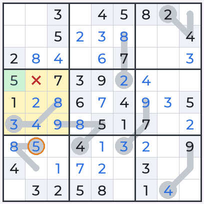

<!-- Written by tools/walkthrough.py thermo: edit the script, not this page. -->
# Thermo, step 29: the 5 in box 4

**Step 29 of 53** · [← Step 28](step-28.md) · [All steps](../thermo.md#the-whole-puzzle-step-by-step) · [Step 30 →](step-30.md)

Box 4 needs a 5. r4c2: column 2 has one (r7c2). Only **r4c1** is left: **r4c1 = 5**.

**Step 29 of 53** · [← Step 28](step-28.md) · [All steps](../thermo.md#the-whole-puzzle-step-by-step) · [Step 30 →](step-30.md)
