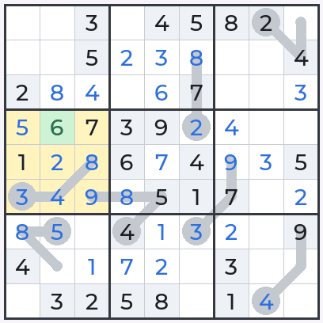

<!-- Written by tools/walkthrough.py thermo: edit the script, not this page. -->
# Thermo, step 30: the 6 in box 4

**Step 30 of 53** · [← Step 29](step-29.md) · [All steps](../thermo.md#the-whole-puzzle-step-by-step) · [Step 31 →](step-31.md)

Box 4 needs a 6, and r4c2 is its last empty cell: **r4c2 = 6**.

**Step 30 of 53** · [← Step 29](step-29.md) · [All steps](../thermo.md#the-whole-puzzle-step-by-step) · [Step 31 →](step-31.md)
