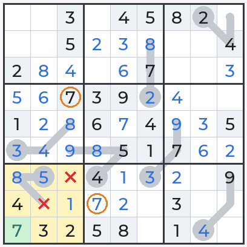

<!-- Written by tools/walkthrough.py thermo: edit the script, not this page. -->
# Thermo, step 32: the 7 in box 7

**Step 32 of 53** · [← Step 31](step-31.md) · [All steps](../thermo.md#the-whole-puzzle-step-by-step) · [Step 33 →](step-33.md)

Box 7 needs a 7. r7c3: column 3 has one (r4c3). r8c2: row 8 has one (r8c4). Only **r9c1** is left: **r9c1 = 7**.

**Step 32 of 53** · [← Step 31](step-31.md) · [All steps](../thermo.md#the-whole-puzzle-step-by-step) · [Step 33 →](step-33.md)
