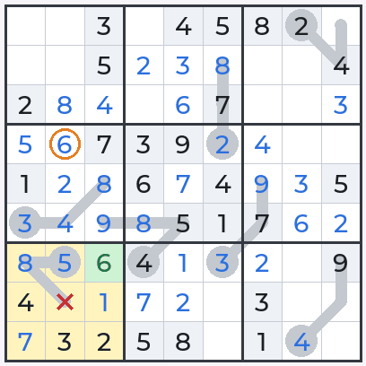

<!-- Written by tools/walkthrough.py thermo: edit the script, not this page. -->
# Thermo, step 33: the 6 in box 7

**Step 33 of 53** · [← Step 32](step-32.md) · [All steps](../thermo.md#the-whole-puzzle-step-by-step) · [Step 34 →](step-34.md)

Box 7 needs a 6. r8c2: column 2 has one (r4c2). Only **r7c3** is left: **r7c3 = 6**.

**Step 33 of 53** · [← Step 32](step-32.md) · [All steps](../thermo.md#the-whole-puzzle-step-by-step) · [Step 34 →](step-34.md)
