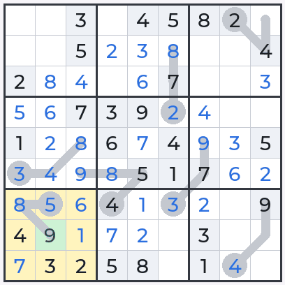

<!-- Written by tools/walkthrough.py thermo: edit the script, not this page. -->
# Thermo, step 34: the 9 in box 7

**Step 34 of 53** · [← Step 33](step-33.md) · [All steps](../thermo.md#the-whole-puzzle-step-by-step) · [Step 35 →](step-35.md)

Box 7 needs a 9, and r8c2 is its last empty cell: **r8c2 = 9**.

**Step 34 of 53** · [← Step 33](step-33.md) · [All steps](../thermo.md#the-whole-puzzle-step-by-step) · [Step 35 →](step-35.md)
