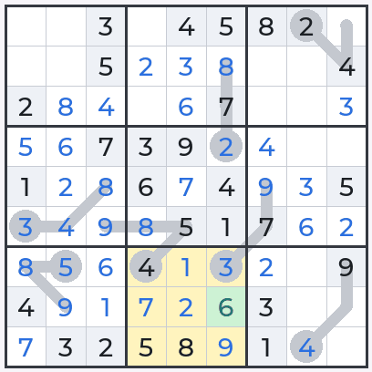

<!-- Written by tools/walkthrough.py thermo: edit the script, not this page. -->
# Thermo, step 36: the 6 in box 8

**Step 36 of 53** · [← Step 35](step-35.md) · [All steps](../thermo.md#the-whole-puzzle-step-by-step) · [Step 37 →](step-37.md)

Box 8 needs a 6, and r8c6 is its last empty cell: **r8c6 = 6**.

**Step 36 of 53** · [← Step 35](step-35.md) · [All steps](../thermo.md#the-whole-puzzle-step-by-step) · [Step 37 →](step-37.md)
