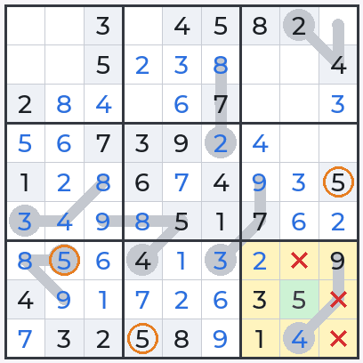

<!-- Written by tools/walkthrough.py thermo: edit the script, not this page. -->
# Thermo, step 37: the 5 in box 9

**Step 37 of 53** · [← Step 36](step-36.md) · [All steps](../thermo.md#the-whole-puzzle-step-by-step) · [Step 38 →](step-38.md)

Box 9 needs a 5. r7c8: row 7 has one (r7c2). r8c9: column 9 has one (r5c9). r9c9: row 9 has one (r9c4). Only **r8c8** is left: **r8c8 = 5**.

**Step 37 of 53** · [← Step 36](step-36.md) · [All steps](../thermo.md#the-whole-puzzle-step-by-step) · [Step 38 →](step-38.md)
