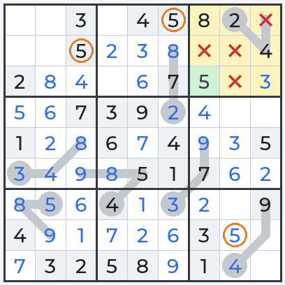

<!-- Written by tools/walkthrough.py thermo: edit the script, not this page. -->
# Thermo, step 38: the 5 in box 3

**Step 38 of 53** · [← Step 37](step-37.md) · [All steps](../thermo.md#the-whole-puzzle-step-by-step) · [Step 39 →](step-39.md)

Box 3 needs a 5. r1c9: row 1 has one (r1c6). r2c7 and r2c8: row 2 has one (r2c3). r3c8: column 8 has one (r8c8). Only **r3c7** is left: **r3c7 = 5**.

**Step 38 of 53** · [← Step 37](step-37.md) · [All steps](../thermo.md#the-whole-puzzle-step-by-step) · [Step 39 →](step-39.md)
