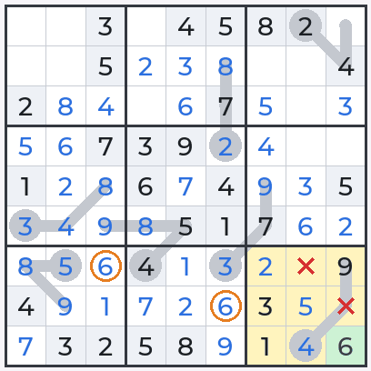

<!-- Written by tools/walkthrough.py thermo: edit the script, not this page. -->
# Thermo, step 39: the 6 in box 9

**Step 39 of 53** · [← Step 38](step-38.md) · [All steps](../thermo.md#the-whole-puzzle-step-by-step) · [Step 40 →](step-40.md)

Box 9 needs a 6. r7c8: row 7 has one (r7c3). r8c9: row 8 has one (r8c6). Only **r9c9** is left: **r9c9 = 6**.

**Step 39 of 53** · [← Step 38](step-38.md) · [All steps](../thermo.md#the-whole-puzzle-step-by-step) · [Step 40 →](step-40.md)
