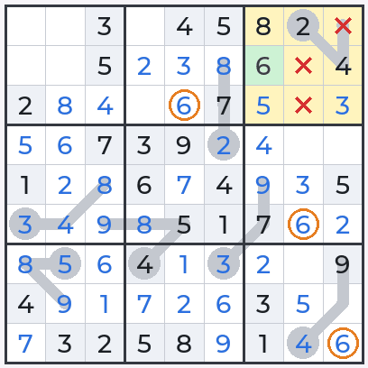

<!-- Written by tools/walkthrough.py thermo: edit the script, not this page. -->
# Thermo, step 40: the 6 in box 3

**Step 40 of 53** · [← Step 39](step-39.md) · [All steps](../thermo.md#the-whole-puzzle-step-by-step) · [Step 41 →](step-41.md)

Box 3 needs a 6. r1c9: column 9 has one (r9c9). r2c8: column 8 has one (r6c8). r3c8: row 3 has one (r3c5). Only **r2c7** is left: **r2c7 = 6**.

**Step 40 of 53** · [← Step 39](step-39.md) · [All steps](../thermo.md#the-whole-puzzle-step-by-step) · [Step 41 →](step-41.md)
