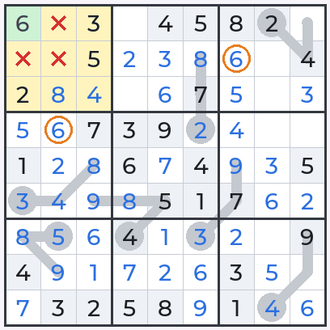

<!-- Written by tools/walkthrough.py thermo: edit the script, not this page. -->
# Thermo, step 41: the 6 in box 1

**Step 41 of 53** · [← Step 40](step-40.md) · [All steps](../thermo.md#the-whole-puzzle-step-by-step) · [Step 42 →](step-42.md)

Box 1 needs a 6. r1c2: column 2 has one (r4c2). r2c1 and r2c2: row 2 has one (r2c7). Only **r1c1** is left: **r1c1 = 6**.

**Step 41 of 53** · [← Step 40](step-40.md) · [All steps](../thermo.md#the-whole-puzzle-step-by-step) · [Step 42 →](step-42.md)
