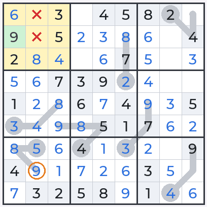

<!-- Written by tools/walkthrough.py thermo: edit the script, not this page. -->
# Thermo, step 42: the 9 in box 1

**Step 42 of 53** · [← Step 41](step-41.md) · [All steps](../thermo.md#the-whole-puzzle-step-by-step) · [Step 43 →](step-43.md)

Box 1 needs a 9. r1c2 and r2c2: column 2 has one (r8c2). Only **r2c1** is left: **r2c1 = 9**.

**Step 42 of 53** · [← Step 41](step-41.md) · [All steps](../thermo.md#the-whole-puzzle-step-by-step) · [Step 43 →](step-43.md)
