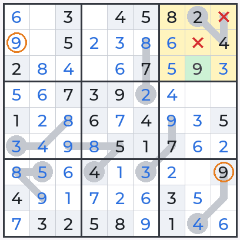

<!-- Written by tools/walkthrough.py thermo: edit the script, not this page. -->
# Thermo, step 43: the 9 in box 3

**Step 43 of 53** · [← Step 42](step-42.md) · [All steps](../thermo.md#the-whole-puzzle-step-by-step) · [Step 44 →](step-44.md)

Box 3 needs a 9. r1c9: column 9 has one (r7c9). r2c8: row 2 has one (r2c1). Only **r3c8** is left: **r3c8 = 9**.

**Step 43 of 53** · [← Step 42](step-42.md) · [All steps](../thermo.md#the-whole-puzzle-step-by-step) · [Step 44 →](step-44.md)
