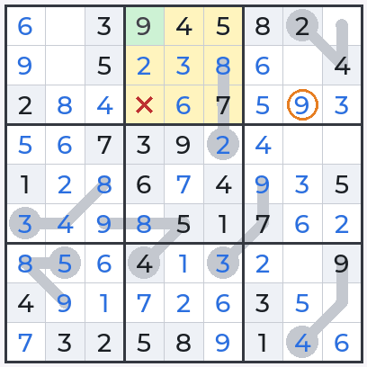

<!-- Written by tools/walkthrough.py thermo: edit the script, not this page. -->
# Thermo, step 44: the 9 in box 2

**Step 44 of 53** · [← Step 43](step-43.md) · [All steps](../thermo.md#the-whole-puzzle-step-by-step) · [Step 45 →](step-45.md)

Box 2 needs a 9. r3c4: row 3 has one (r3c8). Only **r1c4** is left: **r1c4 = 9**.

**Step 44 of 53** · [← Step 43](step-43.md) · [All steps](../thermo.md#the-whole-puzzle-step-by-step) · [Step 45 →](step-45.md)
