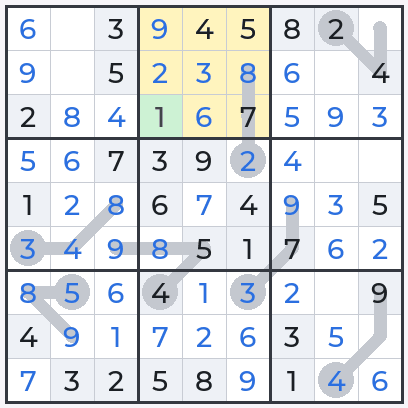

<!-- Written by tools/walkthrough.py thermo: edit the script, not this page. -->
# Thermo, step 45: the 1 in box 2

**Step 45 of 53** · [← Step 44](step-44.md) · [All steps](../thermo.md#the-whole-puzzle-step-by-step) · [Step 46 →](step-46.md)

Box 2 needs a 1, and r3c4 is its last empty cell: **r3c4 = 1**.

**Step 45 of 53** · [← Step 44](step-44.md) · [All steps](../thermo.md#the-whole-puzzle-step-by-step) · [Step 46 →](step-46.md)
