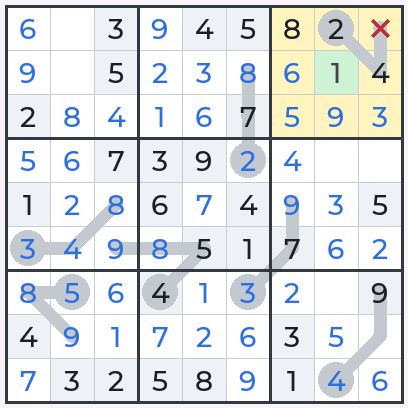

<!-- Written by tools/walkthrough.py thermo: edit the script, not this page. -->
# Thermo, step 46: the 1 in box 3

**Step 46 of 53** · [← Step 45](step-45.md) · [All steps](../thermo.md#the-whole-puzzle-step-by-step) · [Step 47 →](step-47.md)

Box 3 needs a 1. r1c9: its place on its thermometer keeps it between 3 and 9. Only **r2c8** is left: **r2c8 = 1**.

**Step 46 of 53** · [← Step 45](step-45.md) · [All steps](../thermo.md#the-whole-puzzle-step-by-step) · [Step 47 →](step-47.md)
