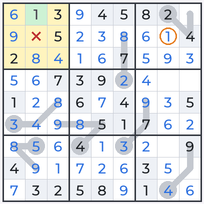

<!-- Written by tools/walkthrough.py thermo: edit the script, not this page. -->
# Thermo, step 47: the 1 in box 1

**Step 47 of 53** · [← Step 46](step-46.md) · [All steps](../thermo.md#the-whole-puzzle-step-by-step) · [Step 48 →](step-48.md)

Box 1 needs a 1. r2c2: row 2 has one (r2c8). Only **r1c2** is left: **r1c2 = 1**.

**Step 47 of 53** · [← Step 46](step-46.md) · [All steps](../thermo.md#the-whole-puzzle-step-by-step) · [Step 48 →](step-48.md)
