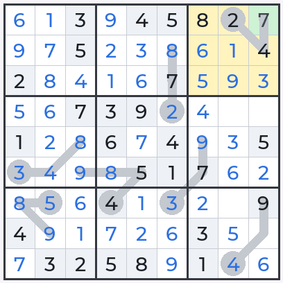

<!-- Written by tools/walkthrough.py thermo: edit the script, not this page. -->
# Thermo, step 49: the 7 in box 3

**Step 49 of 53** · [← Step 48](step-48.md) · [All steps](../thermo.md#the-whole-puzzle-step-by-step) · [Step 50 →](step-50.md)

Box 3 needs a 7, and r1c9 is its last empty cell: **r1c9 = 7**.

**Step 49 of 53** · [← Step 48](step-48.md) · [All steps](../thermo.md#the-whole-puzzle-step-by-step) · [Step 50 →](step-50.md)
