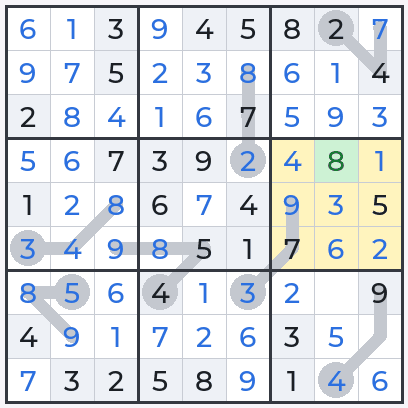

<!-- Written by tools/walkthrough.py thermo: edit the script, not this page. -->
# Thermo, step 51: the 8 in box 6

**Step 51 of 53** · [← Step 50](step-50.md) · [All steps](../thermo.md#the-whole-puzzle-step-by-step) · [Step 52 →](step-52.md)

Box 6 needs an 8, and r4c8 is its last empty cell: **r4c8 = 8**.

**Step 51 of 53** · [← Step 50](step-50.md) · [All steps](../thermo.md#the-whole-puzzle-step-by-step) · [Step 52 →](step-52.md)
