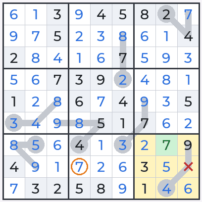

<!-- Written by tools/walkthrough.py thermo: edit the script, not this page. -->
# Thermo, step 52: the 7 in box 9

**Step 52 of 53** · [← Step 51](step-51.md) · [All steps](../thermo.md#the-whole-puzzle-step-by-step) · [Step 53 →](step-53.md)

Box 9 needs a 7. r8c9: row 8 has one (r8c4). Only **r7c8** is left: **r7c8 = 7**.

**Step 52 of 53** · [← Step 51](step-51.md) · [All steps](../thermo.md#the-whole-puzzle-step-by-step) · [Step 53 →](step-53.md)
