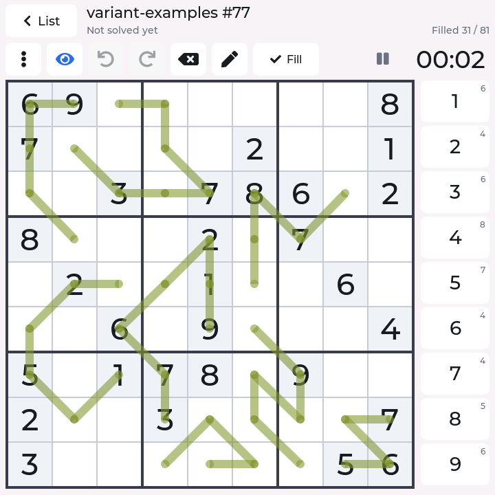
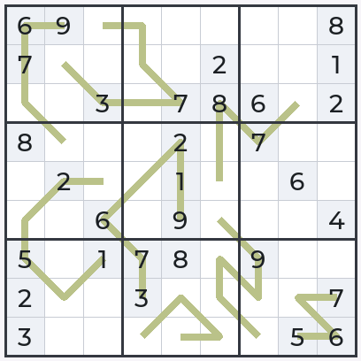

# Weak Palindrome

[← All variants](README.md) · [Puzzles](../features-puzzles.md) · [How to play](../how-to-play.md)

## The rules

[Classic](classic.md) rules, plus **olive lines** through cells side by side or diagonal. Two cells the same distance from a line's middle are **both odd or both even**: its first and last cells match in parity, so do its second and second to last, and so on. A line of five could hold 3, 8, 5, 2, 7; the middle cell of an odd line is free.

Unlike [Palindrome](palindrome.md), mirrored cells needn't hold the same digit, so they may share a row, column or box.

## On the board

- Each line is a translucent olive band under the digits.
- Two mirrored cells, one odd and one even, turn red.
- The grader and hints pass a cell's parity on to the cell mirroring it: "Cells the same distance from this line's middle are both odd or both even, so row 2, column 1 can only be 3".
- **Puzzles → ⋮ → New puzzle → Lines → Weak Pal.**: 8 lines (Hard and Expert 10) of 3 to 7 cells, at all four levels.

## How to solve it

- **A digit on a line gives its mirror's parity:** the mirror of an odd digit can only be 1, 3, 5, 7 or 9; of an even one, 2, 4, 6 or 8.
- **Combine it with the Classic rules:** a cell that its row, column and box leave as 3 or 6 is settled the moment its mirror is filled.
- **There are five odd digits and four even ones** in every row, column and box: a line that puts several mirrored pairs in one box can use them up.

## Worked example

**variant-examples #77**, Weak Palindrome Easy (see [Classic](classic.md#worked-example-the-whole-puzzle) for how to import the examples; cells are written r*row*c*column*). Three lines matter here:

- a line of **five**: r4c2, r3c1, r2c1 (a 7), r1c1 (a 6) and r1c2 (a 9);
- another line of **five**: r5c6, r4c6, r3c6 (an 8), r4c7 (a 7) and r3c8;
- a line of **six**: r9c7, r8c6, r7c6, r8c7, r7c7 (a 9) and r6c6.

**Step 1: r3c1, on the first line.** Row 3 has 2, 3, 6, 7 and 8; column 1 has the 5 in r7c1; box 1 has the 9: that leaves 1 and 4. r3c1 is the line's second cell, mirroring its fourth, r1c1, a 6: even. **r3c1 = 4**.

**Step 2: the 6 in row 4.** r4c2 and r4c3 see the 6 in r6c3, r4c8 and r4c9 the 6s in columns 8 and 9; r4c1, r4c5 and r4c7 are filled. r4c6 is the second line's second cell, mirroring its fourth, r4c7, a 7: odd, so no 6. **r4c4 = 6**.

**Step 3: the 6 in column 6.** The 6s in rows 1, 4 (step 2), 5, 6 and 9 rule out r1c6, r4c6, r5c6, r6c6 and r9c6; r2c6 and r3c6 are filled. r8c6 is the line of six's second cell, mirroring its fifth, r7c7, a 9: odd, so no 6. **r7c6 = 6**.

## The whole puzzle, step by step

<!-- walkthrough -->
<!-- Written by tools/walkthrough.py weak-palindrome: edit the script, not this part. -->

The whole puzzle, from the start to the last cell: 50 steps, each one a single (one place left for a digit, or one digit left for a cell), taken in the order a box's single comes first, so not quite the order of the worked example above. Each step has a page of its own, with **Previous** and **Next**: pick its number below. In each picture, the unit the step looks at is tinted yellow (for a cell with one digit left: its row, column and box), the new digit is on green, the digits that rule cells out have an **orange ring**, and the empty cells they rule out a **red cross**. Givens are on grey, digits from earlier steps in blue.

| [1](weak-palindrome/step-01.md) | [2](weak-palindrome/step-02.md) | [3](weak-palindrome/step-03.md) | [4](weak-palindrome/step-04.md) | [5](weak-palindrome/step-05.md) | [6](weak-palindrome/step-06.md) | [7](weak-palindrome/step-07.md) | [8](weak-palindrome/step-08.md) | [9](weak-palindrome/step-09.md) | [10](weak-palindrome/step-10.md) |
|:-:|:-:|:-:|:-:|:-:|:-:|:-:|:-:|:-:|:-:|
| [11](weak-palindrome/step-11.md) | [12](weak-palindrome/step-12.md) | [13](weak-palindrome/step-13.md) | [14](weak-palindrome/step-14.md) | [15](weak-palindrome/step-15.md) | [16](weak-palindrome/step-16.md) | [17](weak-palindrome/step-17.md) | [18](weak-palindrome/step-18.md) | [19](weak-palindrome/step-19.md) | [20](weak-palindrome/step-20.md) |
| [21](weak-palindrome/step-21.md) | [22](weak-palindrome/step-22.md) | [23](weak-palindrome/step-23.md) | [24](weak-palindrome/step-24.md) | [25](weak-palindrome/step-25.md) | [26](weak-palindrome/step-26.md) | [27](weak-palindrome/step-27.md) | [28](weak-palindrome/step-28.md) | [29](weak-palindrome/step-29.md) | [30](weak-palindrome/step-30.md) |
| [31](weak-palindrome/step-31.md) | [32](weak-palindrome/step-32.md) | [33](weak-palindrome/step-33.md) | [34](weak-palindrome/step-34.md) | [35](weak-palindrome/step-35.md) | [36](weak-palindrome/step-36.md) | [37](weak-palindrome/step-37.md) | [38](weak-palindrome/step-38.md) | [39](weak-palindrome/step-39.md) | [40](weak-palindrome/step-40.md) |
| [41](weak-palindrome/step-41.md) | [42](weak-palindrome/step-42.md) | [43](weak-palindrome/step-43.md) | [44](weak-palindrome/step-44.md) | [45](weak-palindrome/step-45.md) | [46](weak-palindrome/step-46.md) | [47](weak-palindrome/step-47.md) | [48](weak-palindrome/step-48.md) | [49](weak-palindrome/step-49.md) | [50](weak-palindrome/step-50.md) |

Solved.

<!-- /walkthrough -->
