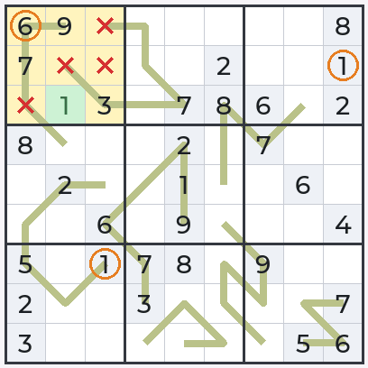

<!-- Written by tools/walkthrough.py weak-palindrome: edit the script, not this page. -->
# Weak Palindrome, step 1: the 1 in box 1

**Step 1 of 50** · [← The start](../weak-palindrome.md#the-whole-puzzle-step-by-step) · [All steps](../weak-palindrome.md#the-whole-puzzle-step-by-step) · [Step 2 →](step-02.md)

Box 1 needs a 1. r1c3: column 3 has one (r7c3). r2c2 and r2c3: row 2 has one (r2c9). r3c1: it mirrors the 6 in r1c1 on its olive line, so it's even too. Only **r3c2** is left: **r3c2 = 1**.

**Step 1 of 50** · [← The start](../weak-palindrome.md#the-whole-puzzle-step-by-step) · [All steps](../weak-palindrome.md#the-whole-puzzle-step-by-step) · [Step 2 →](step-02.md)
