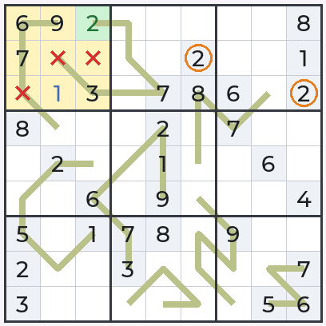

<!-- Written by tools/walkthrough.py weak-palindrome: edit the script, not this page. -->
# Weak Palindrome, step 2: the 2 in box 1

**Step 2 of 50** · [← Step 1](step-01.md) · [All steps](../weak-palindrome.md#the-whole-puzzle-step-by-step) · [Step 3 →](step-03.md)

Box 1 needs a 2. r2c2 and r2c3: row 2 has one (r2c6). r3c1: row 3 has one (r3c9). Only **r1c3** is left: **r1c3 = 2**.

**Step 2 of 50** · [← Step 1](step-01.md) · [All steps](../weak-palindrome.md#the-whole-puzzle-step-by-step) · [Step 3 →](step-03.md)
