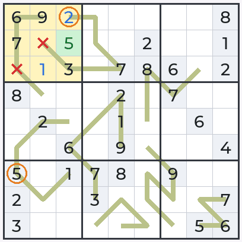

<!-- Written by tools/walkthrough.py weak-palindrome: edit the script, not this page. -->
# Weak Palindrome, step 3: the 5 in box 1

**Step 3 of 50** · [← Step 2](step-02.md) · [All steps](../weak-palindrome.md#the-whole-puzzle-step-by-step) · [Step 4 →](step-04.md)

Box 1 needs a 5. r3c1: column 1 has one (r7c1). r2c2: it mirrors the 2 in r1c3 on its olive line, so it's even too. Only **r2c3** is left: **r2c3 = 5**.

**Step 3 of 50** · [← Step 2](step-02.md) · [All steps](../weak-palindrome.md#the-whole-puzzle-step-by-step) · [Step 4 →](step-04.md)
