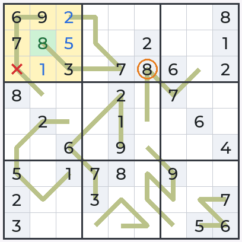

<!-- Written by tools/walkthrough.py weak-palindrome: edit the script, not this page. -->
# Weak Palindrome, step 4: the 8 in box 1

**Step 4 of 50** · [← Step 3](step-03.md) · [All steps](../weak-palindrome.md#the-whole-puzzle-step-by-step) · [Step 5 →](step-05.md)

Box 1 needs an 8. r3c1: row 3 has one (r3c6). Only **r2c2** is left: **r2c2 = 8**.

**Step 4 of 50** · [← Step 3](step-03.md) · [All steps](../weak-palindrome.md#the-whole-puzzle-step-by-step) · [Step 5 →](step-05.md)
