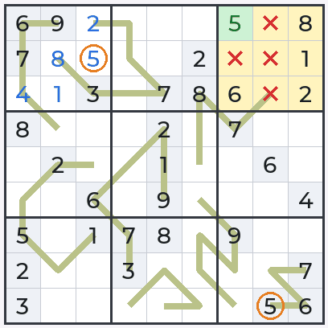

<!-- Written by tools/walkthrough.py weak-palindrome: edit the script, not this page. -->
# Weak Palindrome, step 6: the 5 in box 3

**Step 6 of 50** · [← Step 5](step-05.md) · [All steps](../weak-palindrome.md#the-whole-puzzle-step-by-step) · [Step 7 →](step-07.md)

Box 3 needs a 5. r1c8 and r3c8: column 8 has one (r9c8). r2c7 and r2c8: row 2 has one (r2c3). Only **r1c7** is left: **r1c7 = 5**.

**Step 6 of 50** · [← Step 5](step-05.md) · [All steps](../weak-palindrome.md#the-whole-puzzle-step-by-step) · [Step 7 →](step-07.md)
