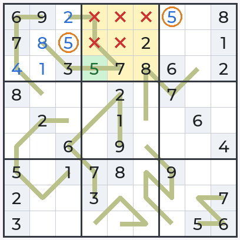

<!-- Written by tools/walkthrough.py weak-palindrome: edit the script, not this page. -->
# Weak Palindrome, step 7: the 5 in box 2

**Step 7 of 50** · [← Step 6](step-06.md) · [All steps](../weak-palindrome.md#the-whole-puzzle-step-by-step) · [Step 8 →](step-08.md)

Box 2 needs a 5. r1c4, r1c5 and r1c6: row 1 has one (r1c7). r2c4 and r2c5: row 2 has one (r2c3). Only **r3c4** is left: **r3c4 = 5**.

**Step 7 of 50** · [← Step 6](step-06.md) · [All steps](../weak-palindrome.md#the-whole-puzzle-step-by-step) · [Step 8 →](step-08.md)
