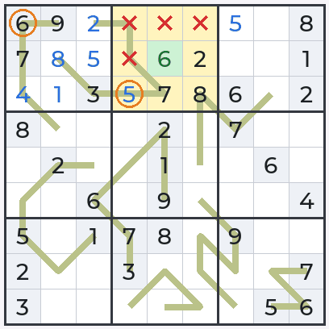

<!-- Written by tools/walkthrough.py weak-palindrome: edit the script, not this page. -->
# Weak Palindrome, step 8: the 6 in box 2

**Step 8 of 50** · [← Step 7](step-07.md) · [All steps](../weak-palindrome.md#the-whole-puzzle-step-by-step) · [Step 9 →](step-09.md)

Box 2 needs a 6. r1c4, r1c5 and r1c6: row 1 has one (r1c1). r2c4: it mirrors the 5 in r3c4 on its olive line, so it's odd too. Only **r2c5** is left: **r2c5 = 6**.

**Step 8 of 50** · [← Step 7](step-07.md) · [All steps](../weak-palindrome.md#the-whole-puzzle-step-by-step) · [Step 9 →](step-09.md)
