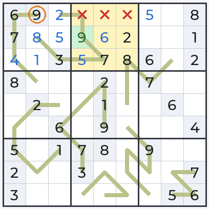

<!-- Written by tools/walkthrough.py weak-palindrome: edit the script, not this page. -->
# Weak Palindrome, step 9: the 9 in box 2

**Step 9 of 50** · [← Step 8](step-08.md) · [All steps](../weak-palindrome.md#the-whole-puzzle-step-by-step) · [Step 10 →](step-10.md)

Box 2 needs a 9. r1c4, r1c5 and r1c6: row 1 has one (r1c2). Only **r2c4** is left: **r2c4 = 9**.

**Step 9 of 50** · [← Step 8](step-08.md) · [All steps](../weak-palindrome.md#the-whole-puzzle-step-by-step) · [Step 10 →](step-10.md)
