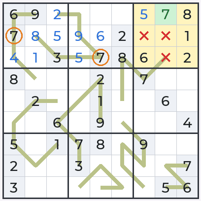

<!-- Written by tools/walkthrough.py weak-palindrome: edit the script, not this page. -->
# Weak Palindrome, step 10: the 7 in box 3

**Step 10 of 50** · [← Step 9](step-09.md) · [All steps](../weak-palindrome.md#the-whole-puzzle-step-by-step) · [Step 11 →](step-11.md)

Box 3 needs a 7. r2c7 and r2c8: row 2 has one (r2c1). r3c8: row 3 has one (r3c5). Only **r1c8** is left: **r1c8 = 7**.

**Step 10 of 50** · [← Step 9](step-09.md) · [All steps](../weak-palindrome.md#the-whole-puzzle-step-by-step) · [Step 11 →](step-11.md)
