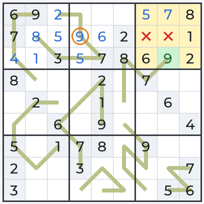

<!-- Written by tools/walkthrough.py weak-palindrome: edit the script, not this page. -->
# Weak Palindrome, step 11: the 9 in box 3

**Step 11 of 50** · [← Step 10](step-10.md) · [All steps](../weak-palindrome.md#the-whole-puzzle-step-by-step) · [Step 12 →](step-12.md)

Box 3 needs a 9. r2c7 and r2c8: row 2 has one (r2c4). Only **r3c8** is left: **r3c8 = 9**.

**Step 11 of 50** · [← Step 10](step-10.md) · [All steps](../weak-palindrome.md#the-whole-puzzle-step-by-step) · [Step 12 →](step-12.md)
