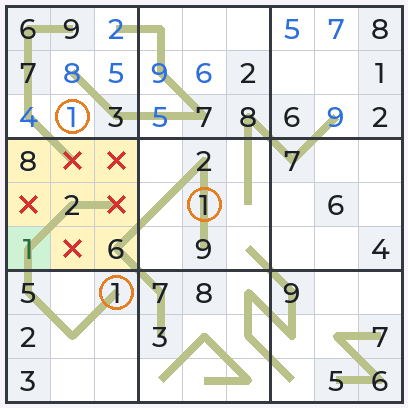

<!-- Written by tools/walkthrough.py weak-palindrome: edit the script, not this page. -->
# Weak Palindrome, step 12: the 1 in box 4

**Step 12 of 50** · [← Step 11](step-11.md) · [All steps](../weak-palindrome.md#the-whole-puzzle-step-by-step) · [Step 13 →](step-13.md)

Box 4 needs a 1. r4c2 and r6c2: column 2 has one (r3c2). r4c3: column 3 has one (r7c3). r5c1 and r5c3: row 5 has one (r5c5). Only **r6c1** is left: **r6c1 = 1**.

**Step 12 of 50** · [← Step 11](step-11.md) · [All steps](../weak-palindrome.md#the-whole-puzzle-step-by-step) · [Step 13 →](step-13.md)
