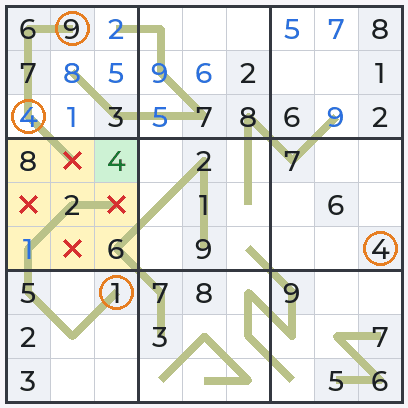

<!-- Written by tools/walkthrough.py weak-palindrome: edit the script, not this page. -->
# Weak Palindrome, step 13: the 4 in box 4

**Step 13 of 50** · [← Step 12](step-12.md) · [All steps](../weak-palindrome.md#the-whole-puzzle-step-by-step) · [Step 14 →](step-14.md)

Box 4 needs a 4. r5c1: column 1 has one (r3c1). r6c2: row 6 has one (r6c9). r4c2: it mirrors the 9 in r1c2 on its olive line, so it's odd too. r5c3: it mirrors the 1 in r7c3 on its olive line, so it's odd too. Only **r4c3** is left: **r4c3 = 4**.

**Step 13 of 50** · [← Step 12](step-12.md) · [All steps](../weak-palindrome.md#the-whole-puzzle-step-by-step) · [Step 14 →](step-14.md)
