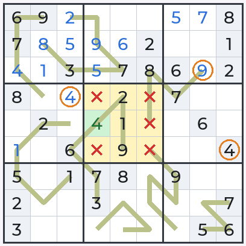

<!-- Written by tools/walkthrough.py weak-palindrome: edit the script, not this page. -->
# Weak Palindrome, step 14: the 4 in box 5

**Step 14 of 50** · [← Step 13](step-13.md) · [All steps](../weak-palindrome.md#the-whole-puzzle-step-by-step) · [Step 15 →](step-15.md)

Box 5 needs a 4. r4c4 and r4c6: row 4 has one (r4c3). r6c4 and r6c6: row 6 has one (r6c9). r5c6: it mirrors the 9 in r3c8 on its olive line, so it's odd too. Only **r5c4** is left: **r5c4 = 4**.

**Step 14 of 50** · [← Step 13](step-13.md) · [All steps](../weak-palindrome.md#the-whole-puzzle-step-by-step) · [Step 15 →](step-15.md)
