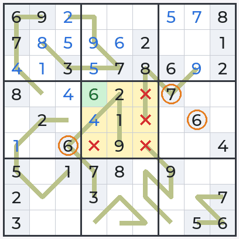

<!-- Written by tools/walkthrough.py weak-palindrome: edit the script, not this page. -->
# Weak Palindrome, step 15: the 6 in box 5

**Step 15 of 50** · [← Step 14](step-14.md) · [All steps](../weak-palindrome.md#the-whole-puzzle-step-by-step) · [Step 16 →](step-16.md)

Box 5 needs a 6. r5c6: row 5 has one (r5c8). r6c4 and r6c6: row 6 has one (r6c3). r4c6: it mirrors the 7 in r4c7 on its olive line, so it's odd too. Only **r4c4** is left: **r4c4 = 6**.

**Step 15 of 50** · [← Step 14](step-14.md) · [All steps](../weak-palindrome.md#the-whole-puzzle-step-by-step) · [Step 16 →](step-16.md)
