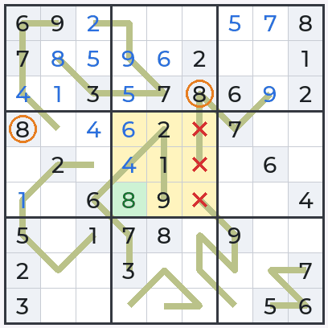

<!-- Written by tools/walkthrough.py weak-palindrome: edit the script, not this page. -->
# Weak Palindrome, step 16: the 8 in box 5

**Step 16 of 50** · [← Step 15](step-15.md) · [All steps](../weak-palindrome.md#the-whole-puzzle-step-by-step) · [Step 17 →](step-17.md)

Box 5 needs an 8. r4c6: row 4 has one (r4c1). r5c6 and r6c6: column 6 has one (r3c6). Only **r6c4** is left: **r6c4 = 8**.

**Step 16 of 50** · [← Step 15](step-15.md) · [All steps](../weak-palindrome.md#the-whole-puzzle-step-by-step) · [Step 17 →](step-17.md)
