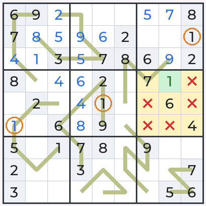

<!-- Written by tools/walkthrough.py weak-palindrome: edit the script, not this page. -->
# Weak Palindrome, step 17: the 1 in box 6

**Step 17 of 50** · [← Step 16](step-16.md) · [All steps](../weak-palindrome.md#the-whole-puzzle-step-by-step) · [Step 18 →](step-18.md)

Box 6 needs a 1. r4c9: column 9 has one (r2c9). r5c7 and r5c9: row 5 has one (r5c5). r6c7 and r6c8: row 6 has one (r6c1). Only **r4c8** is left: **r4c8 = 1**.

**Step 17 of 50** · [← Step 16](step-16.md) · [All steps](../weak-palindrome.md#the-whole-puzzle-step-by-step) · [Step 18 →](step-18.md)
