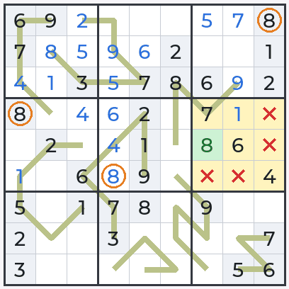

<!-- Written by tools/walkthrough.py weak-palindrome: edit the script, not this page. -->
# Weak Palindrome, step 18: the 8 in box 6

**Step 18 of 50** · [← Step 17](step-17.md) · [All steps](../weak-palindrome.md#the-whole-puzzle-step-by-step) · [Step 19 →](step-19.md)

Box 6 needs an 8. r4c9: row 4 has one (r4c1). r5c9: column 9 has one (r1c9). r6c7 and r6c8: row 6 has one (r6c4). Only **r5c7** is left: **r5c7 = 8**.

**Step 18 of 50** · [← Step 17](step-17.md) · [All steps](../weak-palindrome.md#the-whole-puzzle-step-by-step) · [Step 19 →](step-19.md)
