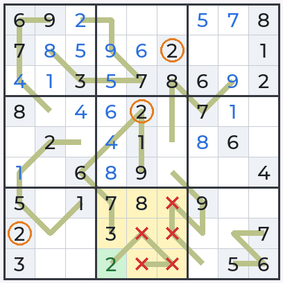

<!-- Written by tools/walkthrough.py weak-palindrome: edit the script, not this page. -->
# Weak Palindrome, step 19: the 2 in box 8

**Step 19 of 50** · [← Step 18](step-18.md) · [All steps](../weak-palindrome.md#the-whole-puzzle-step-by-step) · [Step 20 →](step-20.md)

Box 8 needs a 2. r7c6 and r9c6: column 6 has one (r2c6). r8c5 and r8c6: row 8 has one (r8c1). r9c5: column 5 has one (r4c5). Only **r9c4** is left: **r9c4 = 2**.

**Step 19 of 50** · [← Step 18](step-18.md) · [All steps](../weak-palindrome.md#the-whole-puzzle-step-by-step) · [Step 20 →](step-20.md)
