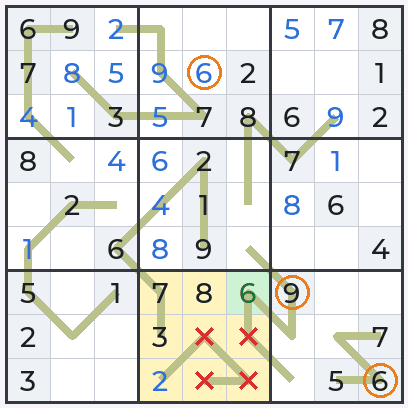

<!-- Written by tools/walkthrough.py weak-palindrome: edit the script, not this page. -->
# Weak Palindrome, step 20: the 6 in box 8

**Step 20 of 50** · [← Step 19](step-19.md) · [All steps](../weak-palindrome.md#the-whole-puzzle-step-by-step) · [Step 21 →](step-21.md)

Box 8 needs a 6. r8c5: column 5 has one (r2c5). r9c5 and r9c6: row 9 has one (r9c9). r8c6: it mirrors the 9 in r7c7 on its olive line, so it's odd too. Only **r7c6** is left: **r7c6 = 6**.

**Step 20 of 50** · [← Step 19](step-19.md) · [All steps](../weak-palindrome.md#the-whole-puzzle-step-by-step) · [Step 21 →](step-21.md)
