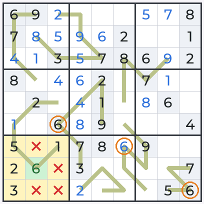

<!-- Written by tools/walkthrough.py weak-palindrome: edit the script, not this page. -->
# Weak Palindrome, step 21: the 6 in box 7

**Step 21 of 50** · [← Step 20](step-20.md) · [All steps](../weak-palindrome.md#the-whole-puzzle-step-by-step) · [Step 22 →](step-22.md)

Box 7 needs a 6. r7c2: row 7 has one (r7c6). r8c3: column 3 has one (r6c3). r9c2 and r9c3: row 9 has one (r9c9). Only **r8c2** is left: **r8c2 = 6**.

**Step 21 of 50** · [← Step 20](step-20.md) · [All steps](../weak-palindrome.md#the-whole-puzzle-step-by-step) · [Step 22 →](step-22.md)
