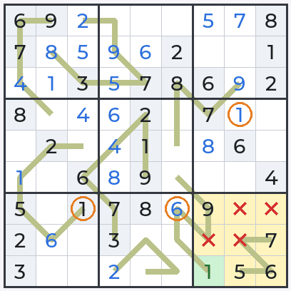

<!-- Written by tools/walkthrough.py weak-palindrome: edit the script, not this page. -->
# Weak Palindrome, step 22: the 1 in box 9

**Step 22 of 50** · [← Step 21](step-21.md) · [All steps](../weak-palindrome.md#the-whole-puzzle-step-by-step) · [Step 23 →](step-23.md)

Box 9 needs a 1. r7c8 and r7c9: row 7 has one (r7c3). r8c8: column 8 has one (r4c8). r8c7: it mirrors the 6 in r7c6 on its olive line, so it's even too. Only **r9c7** is left: **r9c7 = 1**.

**Step 22 of 50** · [← Step 21](step-21.md) · [All steps](../weak-palindrome.md#the-whole-puzzle-step-by-step) · [Step 23 →](step-23.md)
