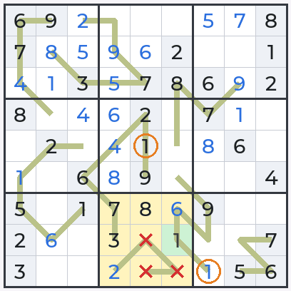

<!-- Written by tools/walkthrough.py weak-palindrome: edit the script, not this page. -->
# Weak Palindrome, step 23: the 1 in box 8

**Step 23 of 50** · [← Step 22](step-22.md) · [All steps](../weak-palindrome.md#the-whole-puzzle-step-by-step) · [Step 24 →](step-24.md)

Box 8 needs a 1. r8c5: column 5 has one (r5c5). r9c5 and r9c6: row 9 has one (r9c7). Only **r8c6** is left: **r8c6 = 1**.

**Step 23 of 50** · [← Step 22](step-22.md) · [All steps](../weak-palindrome.md#the-whole-puzzle-step-by-step) · [Step 24 →](step-24.md)
