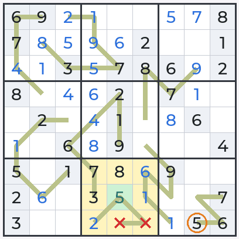

<!-- Written by tools/walkthrough.py weak-palindrome: edit the script, not this page. -->
# Weak Palindrome, step 25: the 5 in box 8

**Step 25 of 50** · [← Step 24](step-24.md) · [All steps](../weak-palindrome.md#the-whole-puzzle-step-by-step) · [Step 26 →](step-26.md)

Box 8 needs a 5. r9c5 and r9c6: row 9 has one (r9c8). Only **r8c5** is left: **r8c5 = 5**.

**Step 25 of 50** · [← Step 24](step-24.md) · [All steps](../weak-palindrome.md#the-whole-puzzle-step-by-step) · [Step 26 →](step-26.md)
