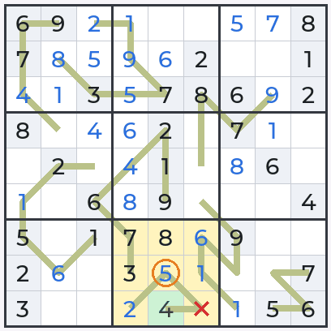

<!-- Written by tools/walkthrough.py weak-palindrome: edit the script, not this page. -->
# Weak Palindrome, step 26: the 4 in box 8

**Step 26 of 50** · [← Step 25](step-25.md) · [All steps](../weak-palindrome.md#the-whole-puzzle-step-by-step) · [Step 27 →](step-27.md)

Box 8 needs a 4. r9c6: it mirrors the 5 in r8c5 on its olive line, so it's odd too. Only **r9c5** is left: **r9c5 = 4**.

**Step 26 of 50** · [← Step 25](step-25.md) · [All steps](../weak-palindrome.md#the-whole-puzzle-step-by-step) · [Step 27 →](step-27.md)
