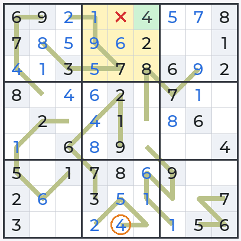

<!-- Written by tools/walkthrough.py weak-palindrome: edit the script, not this page. -->
# Weak Palindrome, step 27: the 4 in box 2

**Step 27 of 50** · [← Step 26](step-26.md) · [All steps](../weak-palindrome.md#the-whole-puzzle-step-by-step) · [Step 28 →](step-28.md)

Box 2 needs a 4. r1c5: column 5 has one (r9c5). Only **r1c6** is left: **r1c6 = 4**.

**Step 27 of 50** · [← Step 26](step-26.md) · [All steps](../weak-palindrome.md#the-whole-puzzle-step-by-step) · [Step 28 →](step-28.md)
