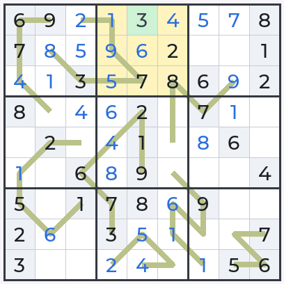

<!-- Written by tools/walkthrough.py weak-palindrome: edit the script, not this page. -->
# Weak Palindrome, step 28: the 3 in box 2

**Step 28 of 50** · [← Step 27](step-27.md) · [All steps](../weak-palindrome.md#the-whole-puzzle-step-by-step) · [Step 29 →](step-29.md)

Box 2 needs a 3, and r1c5 is its last empty cell: **r1c5 = 3**.

**Step 28 of 50** · [← Step 27](step-27.md) · [All steps](../weak-palindrome.md#the-whole-puzzle-step-by-step) · [Step 29 →](step-29.md)
