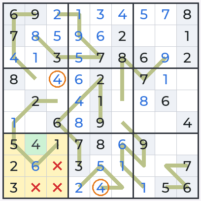

<!-- Written by tools/walkthrough.py weak-palindrome: edit the script, not this page. -->
# Weak Palindrome, step 29: the 4 in box 7

**Step 29 of 50** · [← Step 28](step-28.md) · [All steps](../weak-palindrome.md#the-whole-puzzle-step-by-step) · [Step 30 →](step-30.md)

Box 7 needs a 4. r8c3: column 3 has one (r4c3). r9c2 and r9c3: row 9 has one (r9c5). Only **r7c2** is left: **r7c2 = 4**.

**Step 29 of 50** · [← Step 28](step-28.md) · [All steps](../weak-palindrome.md#the-whole-puzzle-step-by-step) · [Step 30 →](step-30.md)
