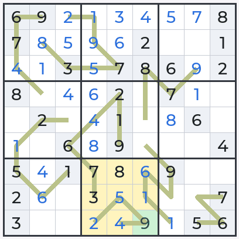

<!-- Written by tools/walkthrough.py weak-palindrome: edit the script, not this page. -->
# Weak Palindrome, step 30: the 9 in box 8

**Step 30 of 50** · [← Step 29](step-29.md) · [All steps](../weak-palindrome.md#the-whole-puzzle-step-by-step) · [Step 31 →](step-31.md)

Box 8 needs a 9, and r9c6 is its last empty cell: **r9c6 = 9**.

**Step 30 of 50** · [← Step 29](step-29.md) · [All steps](../weak-palindrome.md#the-whole-puzzle-step-by-step) · [Step 31 →](step-31.md)
