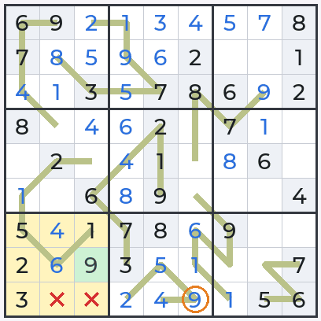

<!-- Written by tools/walkthrough.py weak-palindrome: edit the script, not this page. -->
# Weak Palindrome, step 31: the 9 in box 7

**Step 31 of 50** · [← Step 30](step-30.md) · [All steps](../weak-palindrome.md#the-whole-puzzle-step-by-step) · [Step 32 →](step-32.md)

Box 7 needs a 9. r9c2 and r9c3: row 9 has one (r9c6). Only **r8c3** is left: **r8c3 = 9**.

**Step 31 of 50** · [← Step 30](step-30.md) · [All steps](../weak-palindrome.md#the-whole-puzzle-step-by-step) · [Step 32 →](step-32.md)
